<!-- Project overview -->
<p align="center">
  
</p>

<p align="center">
  <a href="https://github.com/Abdellah-mouida/NewPipe/actions/workflows/ci.yml?query=branch%3Apremium">
    
  </a>
  <a href="https://github.com/Abdellah-mouida/NewPipe/releases">
    
  </a>
  <a href="LICENSE">
    
  </a>
  
</p>

<h1 align="center">NewPipe · Premium UI</h1>

<p align="center">
  An independent, unofficial fork of <a href="https://github.com/TeamNewPipe/NewPipe">NewPipe</a>,
  focused on a cleaner, more refined Android experience while preserving the upstream app's core functionality.
</p>

> **Unofficial project.** This fork is not affiliated with or endorsed by TeamNewPipe. It builds on their open-source work.

---

## The experience

| Area | What changes |
| --- | --- |
| **AMOLED and dark themes** | Deep black surfaces, quieter contrast, and a blue-led accent system with restrained violet highlights. |
| **Navigation** | Floating bottom navigation, a refined side drawer, and clear active states. |
| **Browsing** | Rounded video thumbnails, cleaner stream cards, and more consistent spacing. |
| **Motion** | Subtle transitions, loading states, and responsive touch feedback. |
| **Playback** | NewPipe's established playback experience stays at the center: background and popup playback, playlists, downloads, subtitles, and more. |

The goal is a cohesive interface—not a rewrite of NewPipe's extraction or playback engine.

## Features retained from NewPipe

Search, subscriptions, playlists, watch history, downloads, background playback, popup playback, subtitles, comments, and other core NewPipe features remain part of the project.

Service availability follows the upstream extractor and can change as services evolve. Supported services include YouTube, YouTube Music, PeerTube, Bandcamp, SoundCloud, and media.ccc.de.

## Download and install

Get the latest available APK from **[GitHub Releases](https://github.com/Abdellah-mouida/NewPipe/releases)**.

1. Open the Releases page and download the APK for the version you want.
2. Allow your browser or file manager to install apps from that source when Android asks.
3. Open the APK and follow the installation steps.

**Coming from another NewPipe build?** Android only allows an in-place update when the signing certificates match. Back up your NewPipe data first; when the installed app uses a different signing key, you may need to uninstall it before installing this fork, then restore your backup.

## Build from source

**Requirements:** JDK 21 and Android SDK Platform 37.

```bash
git clone https://github.com/Abdellah-mouida/NewPipe.git
cd NewPipe
git checkout premium
./gradlew assembleContinuous
```

For signed release builds, configure the repository's GitHub Actions secrets:

- `ANDROID_KEYSTORE_BASE64`
- `ANDROID_KEYSTORE_PASSWORD`
- `ANDROID_KEY_ALIAS`
- `ANDROID_KEY_PASSWORD`

Never commit a keystore or signing credentials to the repository.

## Credits and license

This project is based on [TeamNewPipe/NewPipe](https://github.com/TeamNewPipe/NewPipe). The upstream project and its contributors deserve credit for the original application, extractor integration, and the functionality this fork builds upon.

Licensed under the **GNU General Public License v3.0 or later**. See [LICENSE](LICENSE).
